<p align="center">
  
  &nbsp;&nbsp;
  
</p>

# Nib — AI Code Text Editor

<p align="center">
  <a href="https://github.com/JKS-sys/nib-22-sep-2026-releases/releases/latest"></a>
  <a href="https://ipconfig.co.network/nib"></a>
  <a href="https://github.com/JKS-sys/nib-22-sep-2026-releases/releases"></a>
</p>

> **If Nib helps you, please ⭐ star this repository — it helps other people find it.**

**An AI code text editor that opens instantly and never loses your work.** Built with Tauri and Rust — a few MB — a Mac app for Apple silicon.

| | |
|---|---|
| Website | [ipconfig.co.network](https://ipconfig.co.network) |
| Nib's page | [ipconfig.co.network/nib](https://ipconfig.co.network/nib) |
| Releases | [github.com/JKS-sys/nib-22-sep-2026-releases/releases](https://github.com/JKS-sys/nib-22-sep-2026-releases/releases) |

## Install

A Mac app for Apple silicon (M1 and later), installed with [Pour](https://ipconfig.co.network/pour):

```sh
pour install --cask nib
```

No Pour yet? `curl -fsSL https://ipconfig.co.network/pour/install | sh` first. Nib updates itself after that.

**Download 0.4.16:** [latest release](https://github.com/JKS-sys/nib-22-sep-2026-releases/releases/latest) — `Nib_0.4.16_aarch64.dmg`: open it and drag Nib to Applications.

## See it in action

Each clip is recorded from the real app. Click one for the full-quality video.

<p align="center"><a href="assets/demos/startup.mp4"></a></p>

**Start-up.** The nib draws itself in ink, the name rises letter by letter and “By Jagadeesh Kumar S” shines in — then Nib is ready, straight to your work.

<p align="center"><a href="assets/demos/code.mp4">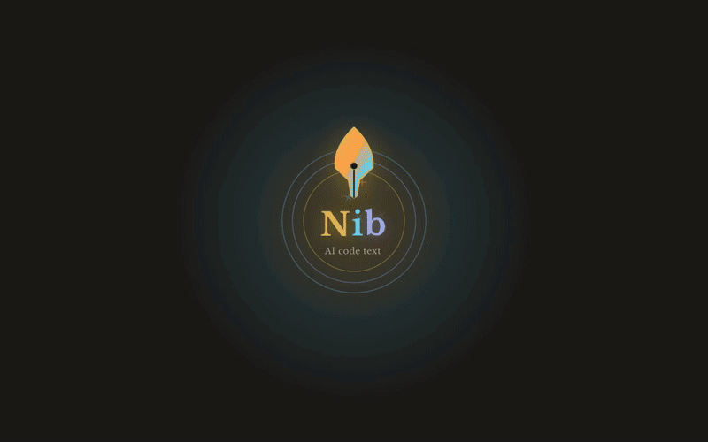</a></p>

**Code in colour.** Rainbow brackets by depth, a colour for every kind of word, and long lines that wrap under their own indent instead of scrolling sideways. The Aa button in the status bar changes the font, size, weight, italic and spacing; right-click gives Transform, Lines, Find, Font and more in neat submenus.

<p align="center"><a href="assets/demos/spreadsheet.mp4">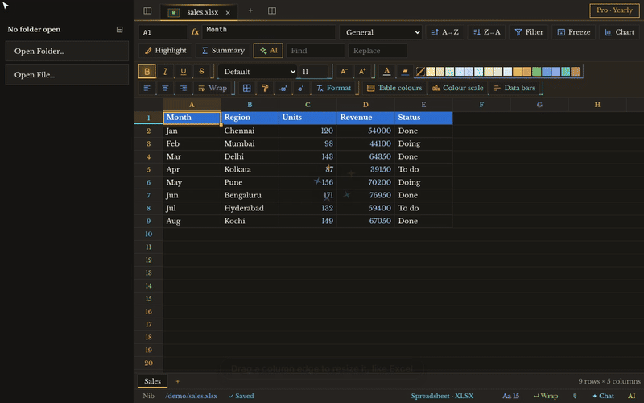</a></p>

**Spreadsheets like Excel.** Drag a column or row edge to resize it (a guide and the size follow the pointer), double-click an edge to fit, right-click a header for width, insert, sort and format. Any font and any size for cells, choice lists with coloured chips, and 448 functions — VSTACK, XMATCH, T.TEST, complex numbers and more.

<p align="center"><a href="assets/demos/reading.mp4">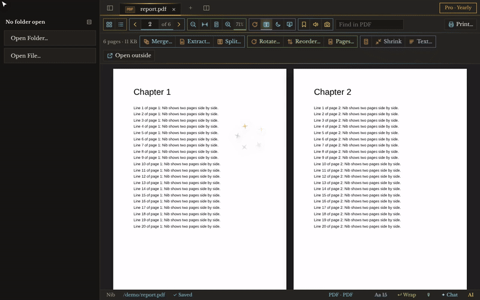</a></p>

**PDFs as two pages.** PDFs open side by side like a printed book; the wheel and the arrow keys turn two pages at a time, and right-click brings every toolbar tool as a menu.

<p align="center"><a href="assets/demos/book.mp4">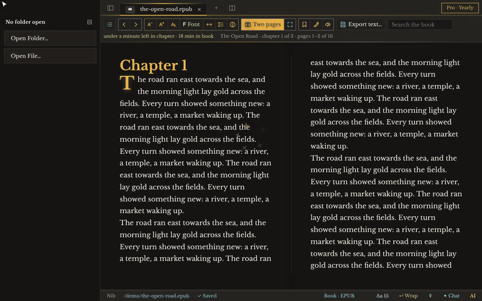</a></p>

**Books like a real book.** EPUBs open as two pages, keep your place, and take any font installed on your computer.

<p align="center"><a href="assets/demos/small-window.mp4">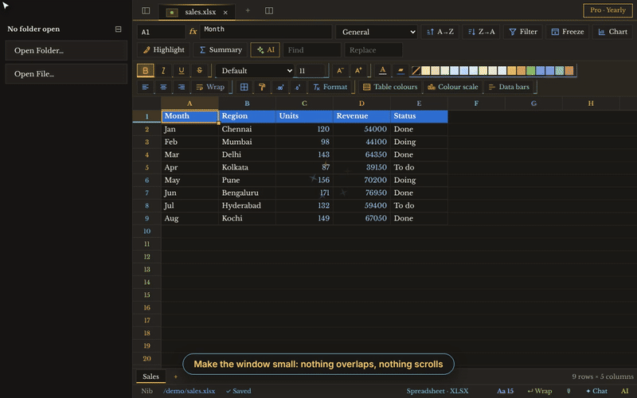</a></p>

**Any window size.** Shrink the window and nothing overlaps or scrolls: tools that do not fit wait behind ⋯, the side bar floats, and everything comes back as the window grows.

<p align="center"><a href="assets/demos/animations.mp4">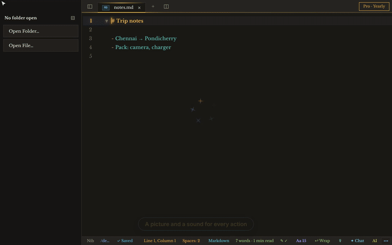</a></p>

**A picture and a sound for every action.** Saving, compressing, extracting, AI at work, two-page view, fonts, charts and more each draw a small vector animation with its own sound (Settings → Animations and Sounds).

## Screenshots

<p align="center">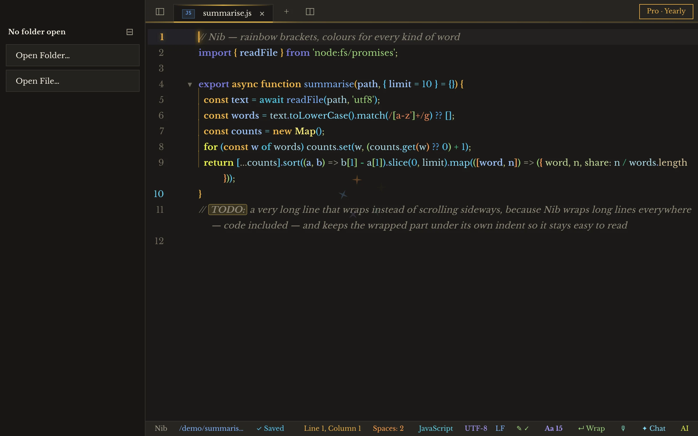</p>

**The editor.** Rainbow brackets, coloured comment tags, wrapped long lines and a status bar where every item has its own colour.

<p align="center">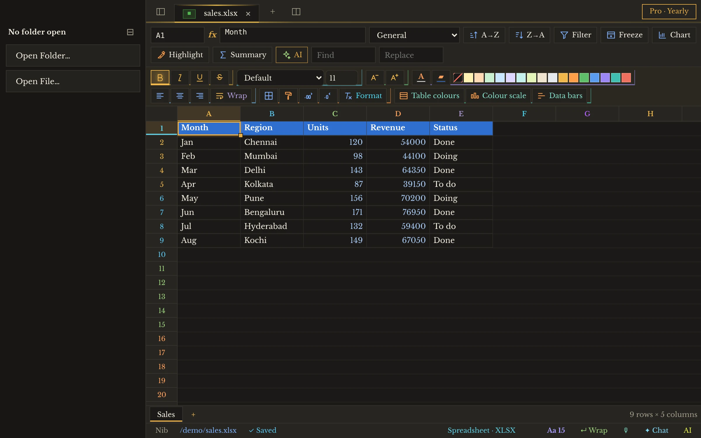</p>

**A spreadsheet.** Excel colours kept, coloured column letters and row numbers, any font and size, and toolbars grouped by colour.

<p align="center">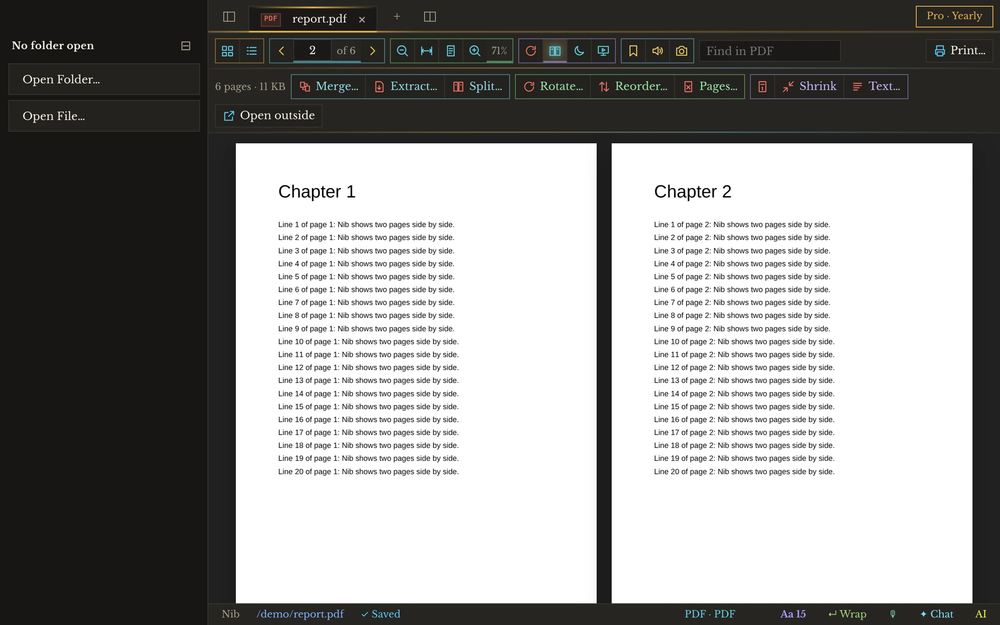</p>

**Two pages side by side** — the default for PDFs and books (Settings → Two pages).

<p align="center">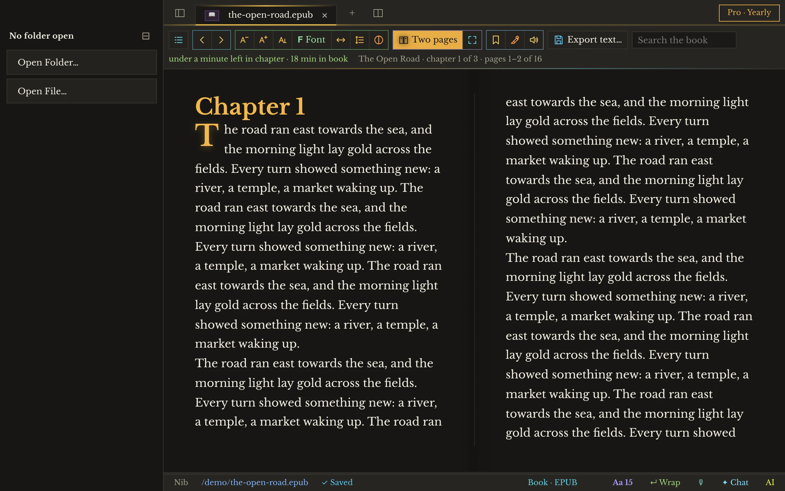</p>

**Books** with reading time, contents, bookmarks, highlights, read-aloud and any font.

<p align="center">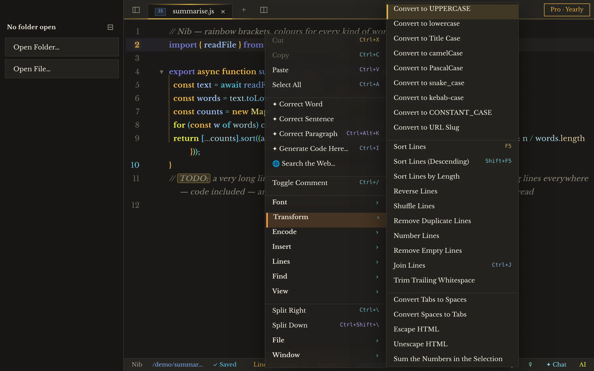</p>

**Right-click everywhere** — submenus, shortcuts, and the keyboard (↑ ↓ → ← Esc) all work.

<p align="center">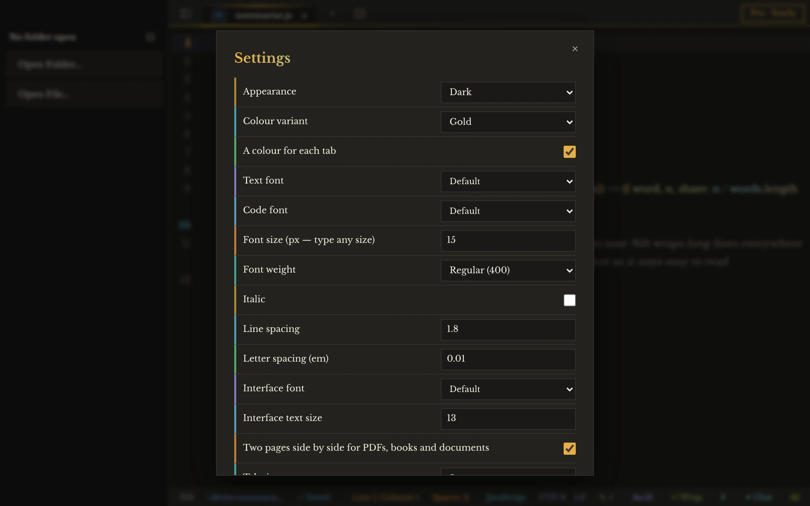</p>

**Fonts with no limits** — text and code fonts, any size from 6 to 400 px, weight, italic, line and letter spacing, and the interface font.

<p align="center">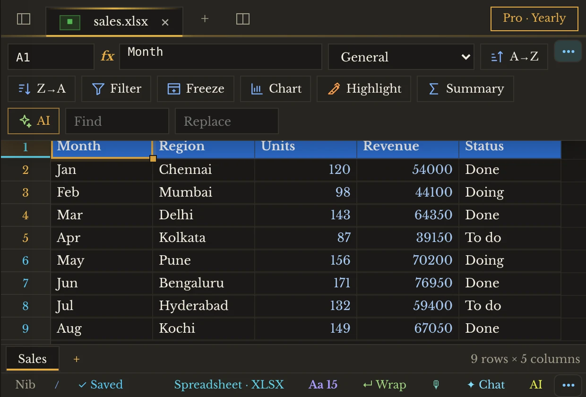</p>

**Small windows** — toolbars fold into ⋯ and unfold over the page.

<p align="center">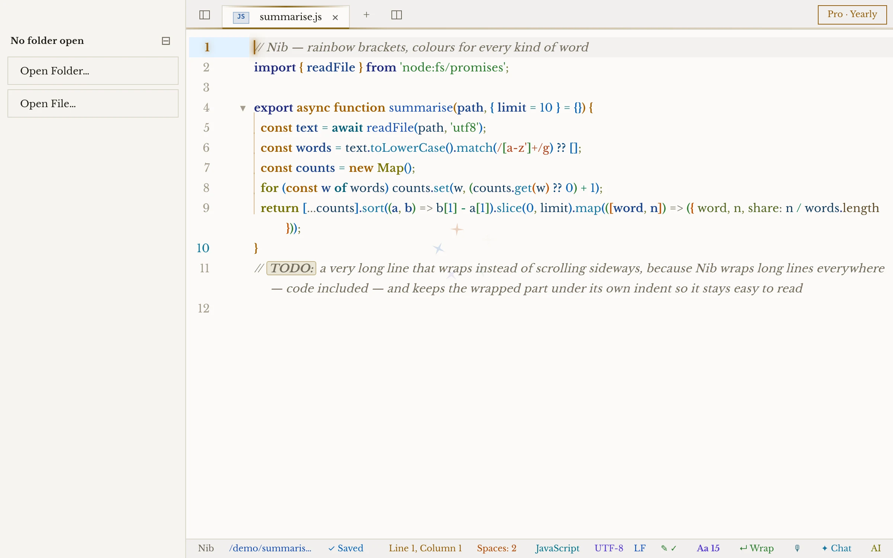</p>

**Light appearance** — the same colours, readable on paper-white.

<p align="center">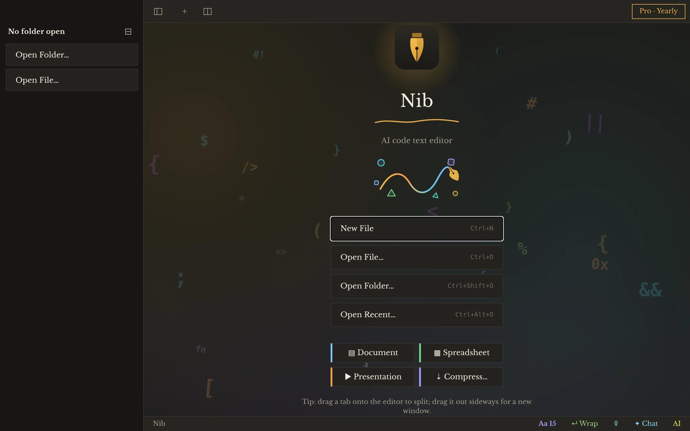</p>

**The start screen.** New File, Open File, Open Folder and Open Recent, plus a new document, spreadsheet or presentation in one click.

<p align="center">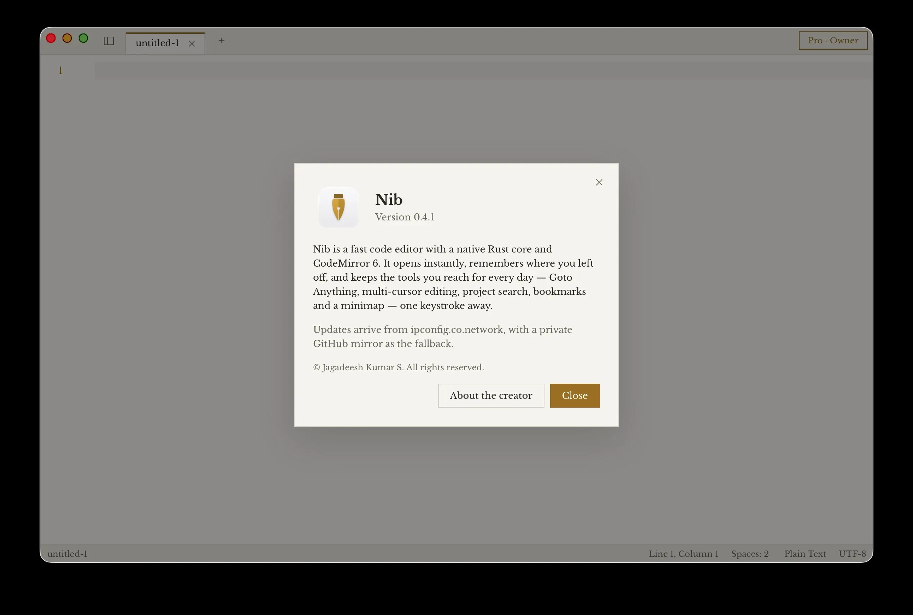</p>

**About Nib.** The version you are running and where its updates come from.

<p align="center">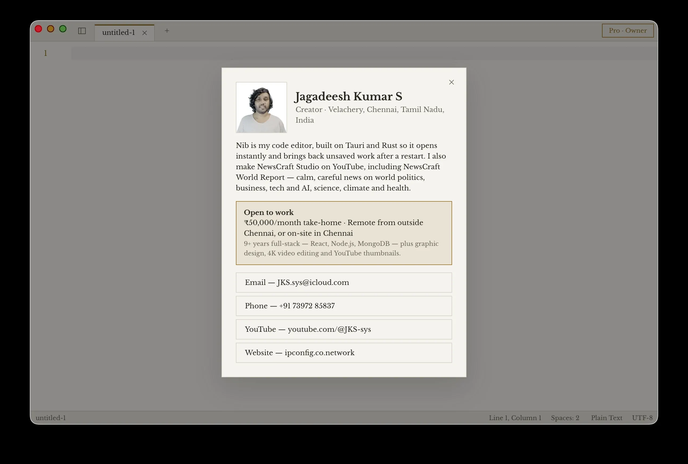</p>

**About the creator.** Jagadeesh Kumar S, a creator in Velachery, Chennai — with his YouTube channel NewsCraft Studio and how to get in touch.

## Features

- **AI as you type** (Pro) — suggestions appear as faint text, Tab accepts; plus Explain, Fix, Generate and Ask about your code
- **AI chat beside any file** (Pro) — ask about it, or have it fill, add, change and delete things: spreadsheet cells and rows, document paragraphs, slides, text. Every change is shown first and undone with one ⌘Z
- **Voice** — dictate into any file or the chat (F8), and run spoken commands: “save”, “split right”, “go to line 40”, “new spreadsheet”, “start the slideshow” (⇧F8)
- **Writing suggestions as you type** — offline spelling, grammar and character checks with one-click fixes (comments only, in code)
- **AI proofreading** (Pro) — correct the word, sentence or paragraph at the cursor, a selection or the whole file, and see every change word by word before applying it
- **Spreadsheets** — CSV, TSV, Excel (.xlsx .xlsm .xls), OpenDocument (.ods) and Apple Numbers files as a grid: 90+ Excel formulas, several sheets, sort, filter, fill, find & replace, number formats, frozen header, copy/paste with Excel
- **Cell formatting, kept in .xlsx** — fill and text colours (Excel's own colours show, theme colours too), bold/italic/underline/strike, sizes, alignment, wrap text with rows that grow, borders, format painter, table colours, colour scales and data bars; smart fill for months, dates, weekdays, quarters and times (Aug-26 → Sep-26)
- **Numbers-style extras** — charts (column, bar, line, pie) that update as you type, checkbox, star-rating and progress-bar cells, conditional highlighting, summaries by category, and templates (budget, invoice, to-do, habit tracker, grade book)
- **Word documents** — open and edit .docx like Word: styles and headings, bold/italic/underline/strikethrough, colours and highlight, sizes, alignment, bulleted and numbered lists, tables, pictures, links, page breaks, word count, zoom, printing, and AI writing (correct, change tone, shorten, lengthen, continue, summarise)
- **Presentations** — open and edit .pptx like PowerPoint and Keynote: text boxes, shapes and pictures you move and resize, slide list, themes, transitions, and a full-screen presenter; AI turns an outline into slides
- **Word extras** — comments in the margin, footnotes and endnotes, Track Changes (record, accept, reject), and the header and footer with page numbers
- **PowerPoint extras** — speaker notes, charts drawn from their data (edit the numbers), tables you edit in place, SmartArt — all kept when saving
- **Old and Apple formats** — .doc, .ppt, .rtf, .odt, .odp, Pages and Keynote open and save back, using macOS's own converter, LibreOffice or Pages/Keynote when present; without any, the text of .doc and .ppt still opens
- **Spreadsheet charts and highlighting saved** — as real Excel charts and conditional formatting that Excel, Numbers and LibreOffice show
- **Password-protected Office files** — Excel, Word and PowerPoint files open with their password and save still protected (the same encryption Office uses)
- **Archives** — opening a zip extracts it beside itself (into its one folder, or a folder named after it) and the window closes; password-protected zips open; .rar, .7z and .tar files extract through the computer's own tools. **Compress…** makes a zip at the strongest setting (files that would not shrink are stored as they are), or tar.xz / tar.zst / 7z / RAR when those tools are present — always lossless, with the saving shown
- **Split archives** — x.zip.001, x.zip.part0 and x.z01 pieces open from any piece; Zip in parts; ZIP64 for files over 4 GB
- **Look Inside zips** — Extract To, Info, Report, Benchmark, exact sizes; browse, sort, filter, extract only what you tick, and test every checksum
- **Pictures** — HEIC, TIFF and other formats the web view can't decode are converted for display; zoom, pan, rotate, flip, step through the folder with ← → or the mouse wheel, slideshow, full screen, a colour picker that copies any pixel's hex code, an info panel, checkerboard for transparency
- **Books** — EPUBs open with their table of contents, search across the whole book, scroll on past a chapter's end to turn the page, page colours (paper, sepia, night), line spacing, minutes left, text size and font choice, a reading-position memory and plain-text export
- **PDFs** — drawn by Nib itself on every system; scroll with the wheel or turn one page per notch in whole-page view, two-page spreads, night reading, full screen, reopens at your page; thumbnails, a contents panel from the PDF's bookmarks, find, zoom and selectable text; page tools: merge, extract, split, rotate, reorder, delete, page numbers, shrink, copy the text
- **Printing** (⌘P) — every kind of tab, with a live preview on paper: paper, orientation, margins, colour or black & white, a header on every page; code keeps its syntax colours and line numbers; sheets, slides (handouts, notes), PDF page ranges, pictures and books
- **Search the web** — DuckDuckGo, Bing, Google, Mojeek, Yahoo and Wikipedia asked at once; blocked engines are skipped and the rest merged, with sources in the AI chat
- **300 spreadsheet functions** — including money (PMT, FV, PV, NPER, RATE, NPV, IRR, depreciation), statistics (percentiles, correlation, regression, normal distribution), engineering (CONVERT, BIN/HEX/OCT, bit operations), dates (NETWORKDAYS, WORKDAY, YEARFRAC) and database functions (DSUM…), checked against LibreOffice Calc
- **Crash reports** — if Nib ever closes unexpectedly, it offers to send an anonymous report next time (version, system, the error and where — never your files); the owner reads them in the Owner Panel, in full, and exports them as .txt or .md
- **Owner Panel** (the owner's Mac only — its serial is the key, nothing to type) — its own window with licence codes (generate, revoke, restore, extend, annotate, delete), every subscription in detail with create / pause / resume / plan change / customer / note / issue code / cancel / delete, and the crash reports
- **Opens with a double-click** — Make Nib the Default Opener registers every type Nib handles: text and code, spreadsheets, Word and PowerPoint files (old and Apple formats too), pictures, PDFs, EPUBs and archives
- **Mouse page-turning** — the wheel, a swipe, or the mouse's Back / Forward buttons turn pages in PDFs, books, pictures and slides
- **Colour for early understanding** (never pink) — keywords, operators, punctuation and comments split by kind, TODO/FIXME tags, colour swatches you click to change, the word under the cursor echoed, sixteen file-kind colours across the side bar and tabs, rainbow brackets *and* indent guides (seven hues; the cursor's pair and block glow), a syntax-coloured formula bar in spreadsheets, coloured code in AI chat replies, a hue for each tab and status-bar item
- **Every local AI** — finds Ollama, LM Studio, Jan, GPT4All, LocalAI, llama.cpp, KoboldCpp, text-generation-webui, vLLM, LiteLLM, Msty and Llamafile running on your computer and uses their models in one click; pulls Ollama models by name; adds any GGUF model from Hugging Face (checksum-verified)
- **13 offline AI models** to download, run and remove on your own computer — free and private; or **GitHub Copilot**, or any AI service by its URL
- **Always knows what is unsaved** — compared with the file on disk, not guessed: a change gutter, Compare with Saved, and a warning when another app changes the file
- **Never loses your work** — ⌘Q keeps unsaved and untitled files, spreadsheets, documents and decks too; they come back on the next launch
- **Split panes**, **named windows**, **Markdown preview**, **five colour variants** with a colour for each tab, **thirteen sound packs**, **background sounds** (rain, ocean, brown noise, wind, fireplace, night), sparks as you type, a glowing cursor, file-type badges and animations throughout
- **80+ languages**, SQLite databases in a read-only viewer, side-bar file actions, Goto Anything (⌘T), multi-cursor, find in folder, bookmarks, minimap, JSON / Base64 / URL tools

**Free:** everything above except the items marked Pro, Find in Folder, Goto Symbol, multi-cursor tools, bookmarks, text tools, minimap, auto save and distraction-free mode.
**Pro (₹20/month or ₹220/year):** AI, plus all of those.

## What's new in 0.4.16

- Spreadsheets: find a sheet by name — the new list button at the bottom left (or ⌥⌘K) shows every sheet; type any words of its name (accents ignored), ↑↓ and Return to open it
- Spreadsheets: the name box takes sheets too — type a sheet's name, or Sales!B4 / 'Q1 2026'!A1:D9 to jump straight to a cell on another sheet
- Spreadsheets: ⌥⌘→ / ⌥⌘← (or ⌃PageDown / ⌃PageUp) go to the next or previous sheet; right-click a sheet tab to Move Left / Move Right; each tab has its own colour
- Saving an .xlsx no longer warns that colours will be lost: fonts, colours, fills, borders, alignment and row heights are kept (the question now appears only when saving as .xls, .ods or another older format)
- Spreadsheets: every cell has its border now — the grid lines are drawn for empty cells too, in a stronger colour, in both themes
- Spreadsheets: AI Chat changes many cells at once — "fill D2:D40 with =B*C", "translate column B", "fix every date in C" — shown first, applied as one undo step (the new Chat button, or right-click → AI Chat)
- Dropping or pasting a video (.mp4, .mov…), music, an installer or another file Nib can't show as text into the editor types its name; into any text box (chat, find, a cell) every file's name is typed. Dropped on the window, files open as before
- Tools (7-Zip, zstd, unar, the office converter, Ollama) are found in Pour's folders first; Homebrew is no longer looked at, and Pour's folders are on the PATH Nib gives the programs it runs
- Nib is now a Mac app for Apple silicon, installed with `pour install --cask nib`; the Homebrew cask is gone
- Activity log (⇧⌘Y, or the new button in the status bar): a log box that writes down what Nib did — opened, saved, AI answers, cells the chat changed, names typed, every problem — each line in its kind's colour with its own sound and picture, live counts, Copy, Expand and Clear
- 27 new self-drawing pictures (grid, fill, chat, drop, pour, warning, sort, filter, link, terminal, sync, lock, rocket, folder, palette, paste, cut, brackets, split, pin, zoom, clock, broom, log done/problem…) and 30 new sounds; now every one of Nib's 142 sounds has its picture
- More colour, never pink: every status bar item, right-click menu row, palette row and inactive tab in its own hue; chat messages and each planned change coloured by kind; spreadsheet money gold, percent teal, dates sky, negatives amber, links blue; the cursor's line number lit
- Drawn icons replace the last emoji (web search, microphone, lock, bookmark, picture, speaker, camera, timer…)
- Signed with the Apple Developer ID and notarised by Apple: no more "unidentified developer" warning. Because the signature changes once, macOS may ask one more time for the folders Nib may open
- Owner Panel: it now opens on the Mac Studio only (the owner list held the test Mac by mistake). The app keeps a hash of the owner's serial, never the serial itself, and the Worker checks the same hash
- Errors are collected: page errors, failed actions, error notices and last run's crashes go anonymously to the owner's dashboard and the Owner Panel (versions, system, message, where; home folders, file paths and e-mail addresses are blanked; repeats counted; up to 50 a session; offline ones kept). Turn it off with the command "Send Error Reports (On/Off)"
- Records moved to dated stores: the Worker now keeps codes, licences, orders, subscriptions and crash reports in the dashboard database nib-07-nov-2026 and key-value nib-kv-07-nov-2026 (copied from D1 with a three-way catch-up; no D1 or Workers KV binding any more)

See [RELEASE_NOTES.md](RELEASE_NOTES.md). Made by Jagadeesh Kumar S, creator · [YouTube](https://www.youtube.com/@JKS-sys)

---

> **If Nib helps you, please ⭐ star this repository — it helps other people find it.**
