<p align="center">
  
  &nbsp;&nbsp;
  
</p>

# Nib — AI Code Text Editor

<p align="center">
  <a href="https://github.com/JKS-sys/nib-22-sep-2026-releases/releases/latest"></a>
  <a href="https://ipconfig.co.network/nib"></a>
  <a href="https://github.com/JKS-sys/nib-22-sep-2026-releases/releases"></a>
</p>

**An AI code text editor that opens instantly and never loses your work.** Built with Tauri and Rust — a few MB per platform — for macOS, Windows and Linux.

| | |
|---|---|
| Website | [ipconfig.co.network](https://ipconfig.co.network) |
| Nib's page | [ipconfig.co.network/nib](https://ipconfig.co.network/nib) |
| Releases | [github.com/JKS-sys/nib-22-sep-2026-releases/releases](https://github.com/JKS-sys/nib-22-sep-2026-releases/releases) |

## Install

**One command — macOS and Linux** (curl):

```sh
curl -fsSL https://raw.githubusercontent.com/JKS-sys/nib-22-sep-2026-releases/main/install.sh | sh
```

**One command — Windows** (PowerShell):

```powershell
irm https://raw.githubusercontent.com/JKS-sys/nib-22-sep-2026-releases/main/install.ps1 | iex
```

**macOS — Homebrew** (no tap, no extra repository — the cask file is right here):

```sh
curl -fsSL https://raw.githubusercontent.com/JKS-sys/nib-22-sep-2026-releases/main/nib.rb -o /tmp/nib.rb && brew install --cask /tmp/nib.rb
```

Update later with `brew upgrade nib` (Nib also updates itself).

**Download 0.4.12:** [latest release](https://github.com/JKS-sys/nib-22-sep-2026-releases/releases/latest)

| Platform | File |
|---|---|
| macOS Apple Silicon | `Nib_0.4.12_aarch64.dmg` |
| macOS Intel | `Nib_0.4.12_x64.dmg` |
| Windows | `Nib_0.4.12_x64-setup.exe` |
| Linux | `Nib_0.4.12_amd64.AppImage` / `.deb` |

- **macOS:** open the .dmg and drag Nib to Applications. If it says Nib is damaged, run `xattr -cr /Applications/Nib.app`.
- **Windows:** run the setup .exe.
- **Linux.** Install the `.deb` with your package manager, or make the AppImage executable and run it:
  ```sh
  sudo apt install ./Nib_0.4.12_amd64.deb
  # or
  chmod +x Nib_0.4.12_amd64.AppImage && ./Nib_0.4.12_amd64.AppImage
  ```

## See it in action

Each clip is recorded from the real app. Click one for the full-quality video.

<p align="center"><a href="assets/demos/startup.mp4"></a></p>

**Start-up.** The nib draws itself in ink, the name rises letter by letter and “By Jagadeesh Kumar S” shines in — then Nib is ready, straight to your work.

<p align="center"><a href="assets/demos/code.mp4">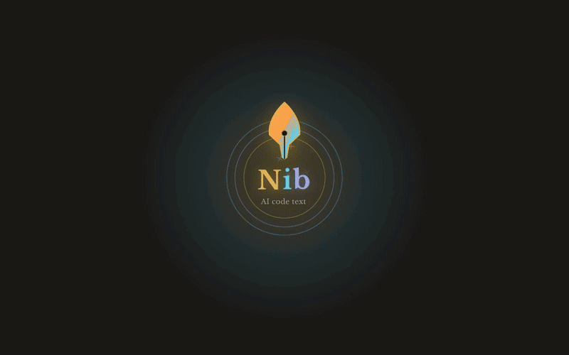</a></p>

**Code in colour.** Rainbow brackets by depth, a colour for every kind of word, and long lines that wrap under their own indent instead of scrolling sideways. The Aa button in the status bar changes the font, size, weight, italic and spacing; right-click gives Transform, Lines, Find, Font and more in neat submenus.

<p align="center"><a href="assets/demos/spreadsheet.mp4">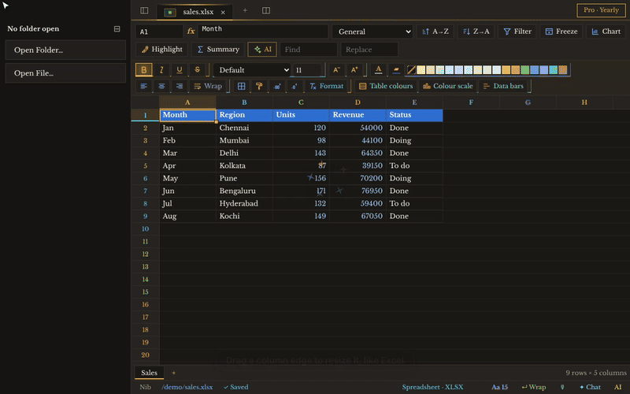</a></p>

**Spreadsheets like Excel.** Drag a column or row edge to resize it (a guide and the size follow the pointer), double-click an edge to fit, right-click a header for width, insert, sort and format. Any font and any size for cells, choice lists with coloured chips, and 448 functions — VSTACK, XMATCH, T.TEST, complex numbers and more.

<p align="center"><a href="assets/demos/reading.mp4">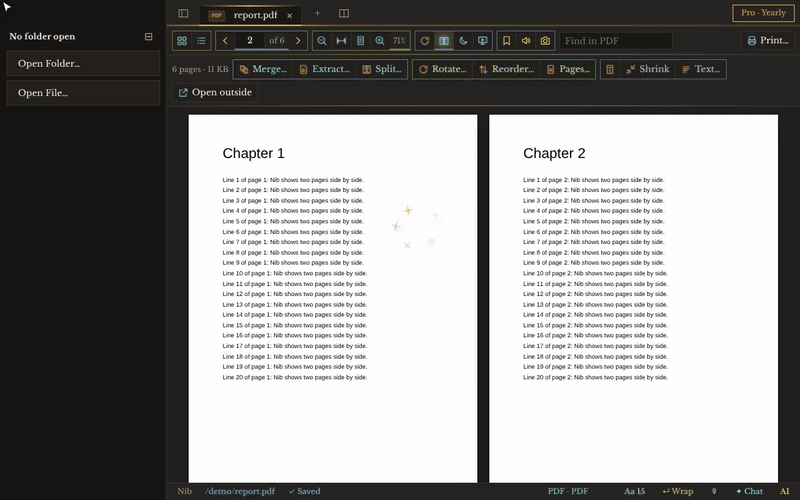</a></p>

**PDFs as two pages.** PDFs open side by side like a printed book; the wheel and the arrow keys turn two pages at a time, and right-click brings every toolbar tool as a menu.

<p align="center"><a href="assets/demos/book.mp4">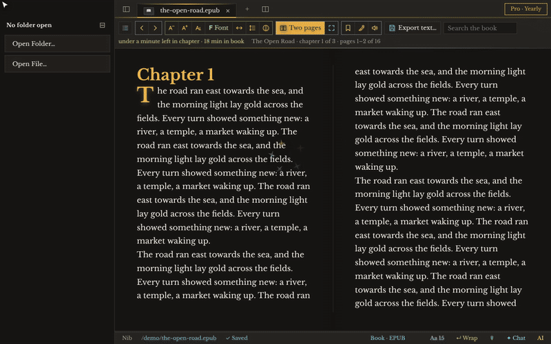</a></p>

**Books like a real book.** EPUBs open as two pages, keep your place, and take any font installed on your computer.

<p align="center"><a href="assets/demos/small-window.mp4">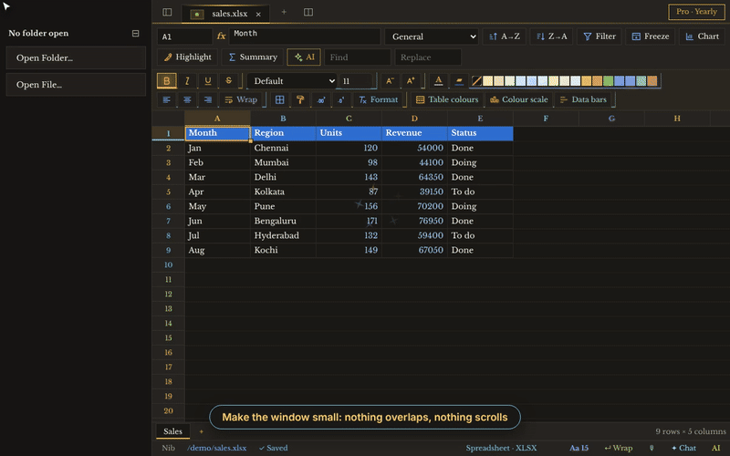</a></p>

**Any window size.** Shrink the window and nothing overlaps or scrolls: tools that do not fit wait behind ⋯, the side bar floats, and everything comes back as the window grows.

<p align="center"><a href="assets/demos/animations.mp4">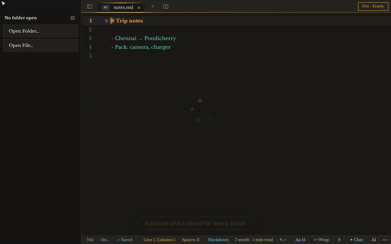</a></p>

**A picture and a sound for every action.** Saving, compressing, extracting, AI at work, two-page view, fonts, charts and more each draw a small vector animation with its own sound (Settings → Animations and Sounds).

## Screenshots

<p align="center">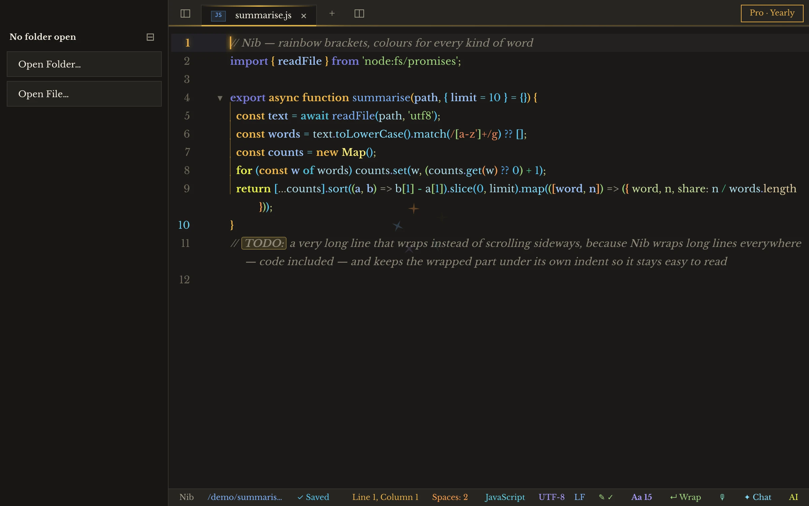</p>

**The editor.** Rainbow brackets, coloured comment tags, wrapped long lines and a status bar where every item has its own colour.

<p align="center">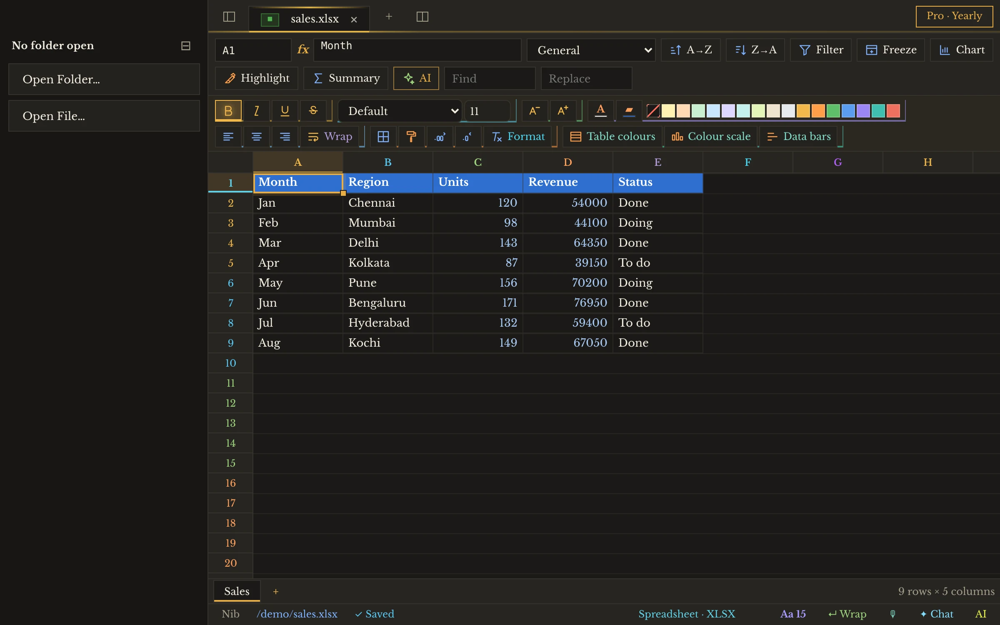</p>

**A spreadsheet.** Excel colours kept, coloured column letters and row numbers, any font and size, and toolbars grouped by colour.

<p align="center">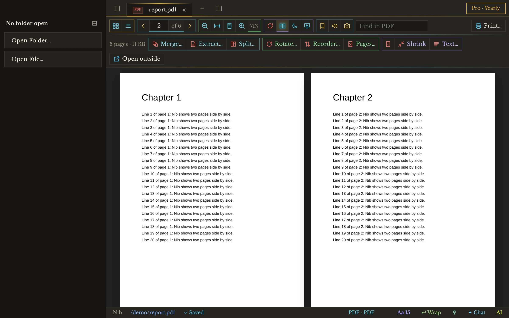</p>

**Two pages side by side** — the default for PDFs and books (Settings → Two pages).

<p align="center">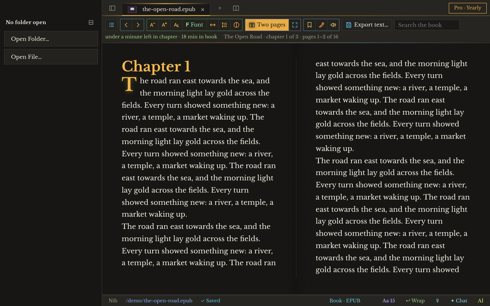</p>

**Books** with reading time, contents, bookmarks, highlights, read-aloud and any font.

<p align="center">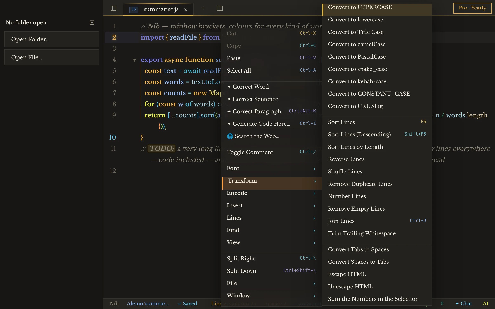</p>

**Right-click everywhere** — submenus, shortcuts, and the keyboard (↑ ↓ → ← Esc) all work.

<p align="center">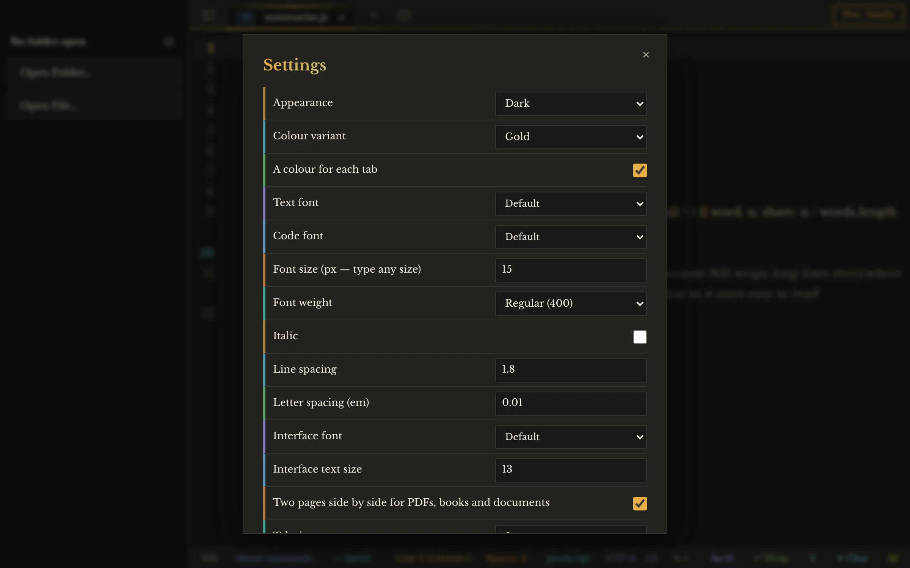</p>

**Fonts with no limits** — text and code fonts, any size from 6 to 400 px, weight, italic, line and letter spacing, and the interface font.

<p align="center">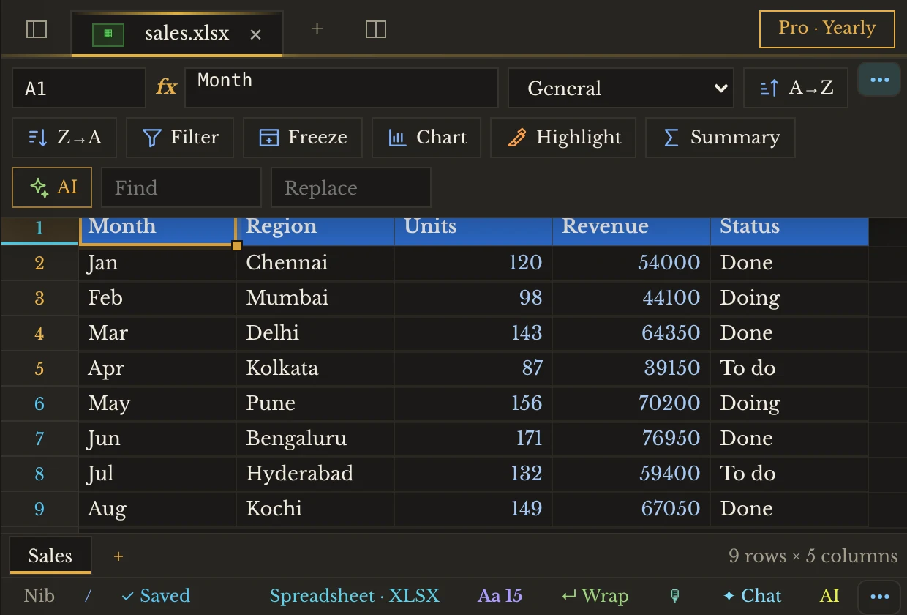</p>

**Small windows** — toolbars fold into ⋯ and unfold over the page.

<p align="center">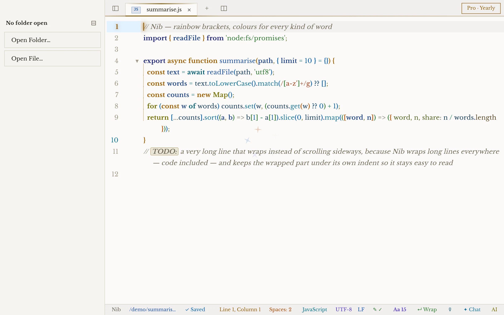</p>

**Light appearance** — the same colours, readable on paper-white.

<p align="center">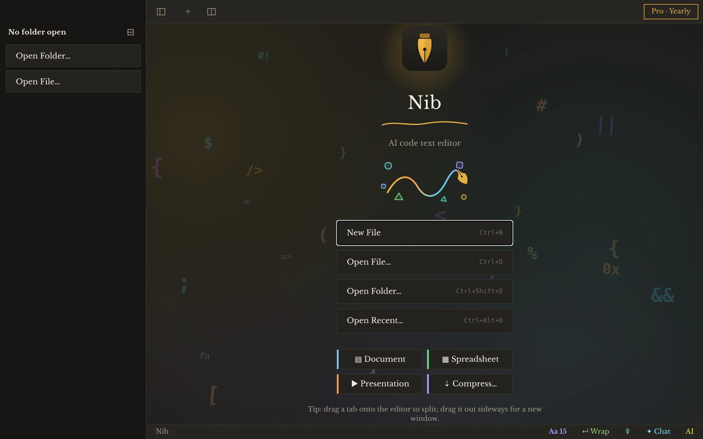</p>

**The start screen.** New File, Open File, Open Folder and Open Recent, plus a new document, spreadsheet or presentation in one click.

<p align="center">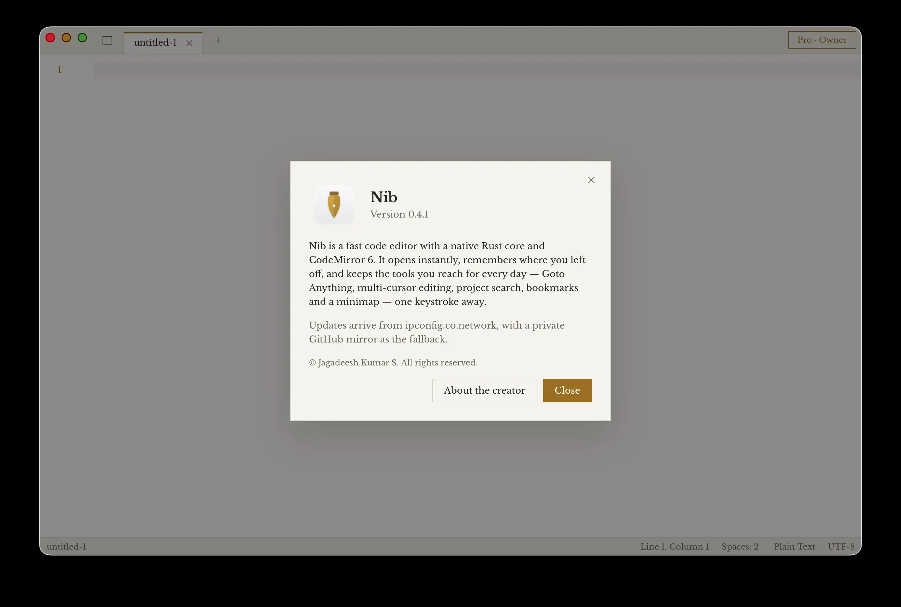</p>

**About Nib.** The version you are running and where its updates come from.

<p align="center">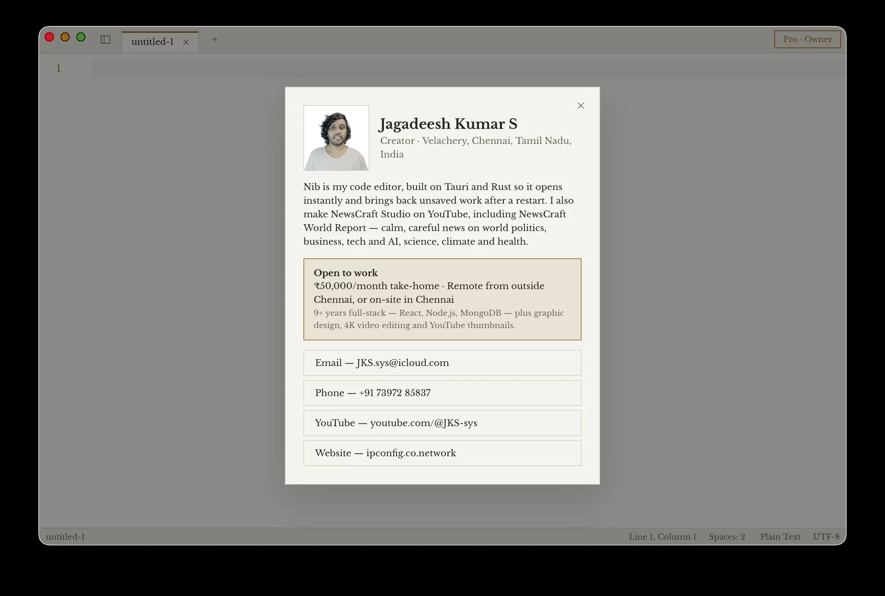</p>

**About the creator.** Jagadeesh Kumar S, a creator in Velachery, Chennai — with his YouTube channel NewsCraft Studio and how to get in touch.

## Features

- **AI as you type** (Pro) — suggestions appear as faint text, Tab accepts; plus Explain, Fix, Generate and Ask about your code
- **AI chat beside any file** (Pro) — ask about it, or have it fill, add, change and delete things: spreadsheet cells and rows, document paragraphs, slides, text. Every change is shown first and undone with one ⌘Z
- **Voice** — dictate into any file or the chat (F8), and run spoken commands: “save”, “split right”, “go to line 40”, “new spreadsheet”, “start the slideshow” (⇧F8)
- **Writing suggestions as you type** — offline spelling, grammar and character checks with one-click fixes (comments only, in code)
- **AI proofreading** (Pro) — correct the word, sentence or paragraph at the cursor, a selection or the whole file, and see every change word by word before applying it
- **Spreadsheets** — CSV, TSV, Excel (.xlsx .xlsm .xls), OpenDocument (.ods) and Apple Numbers files as a grid: 90+ Excel formulas, several sheets, sort, filter, fill, find & replace, number formats, frozen header, copy/paste with Excel
- **Cell formatting, kept in .xlsx** — fill and text colours (Excel's own colours show, theme colours too), bold/italic/underline/strike, sizes, alignment, wrap text with rows that grow, borders, format painter, table colours, colour scales and data bars; smart fill for months, dates, weekdays, quarters and times (Aug-26 → Sep-26)
- **Numbers-style extras** — charts (column, bar, line, pie) that update as you type, checkbox, star-rating and progress-bar cells, conditional highlighting, summaries by category, and templates (budget, invoice, to-do, habit tracker, grade book)
- **Word documents** — open and edit .docx like Word: styles and headings, bold/italic/underline/strikethrough, colours and highlight, sizes, alignment, bulleted and numbered lists, tables, pictures, links, page breaks, word count, zoom, printing, and AI writing (correct, change tone, shorten, lengthen, continue, summarise)
- **Presentations** — open and edit .pptx like PowerPoint and Keynote: text boxes, shapes and pictures you move and resize, slide list, themes, transitions, and a full-screen presenter; AI turns an outline into slides
- **Word extras** — comments in the margin, footnotes and endnotes, Track Changes (record, accept, reject), and the header and footer with page numbers
- **PowerPoint extras** — speaker notes, charts drawn from their data (edit the numbers), tables you edit in place, SmartArt — all kept when saving
- **Old and Apple formats** — .doc, .ppt, .rtf, .odt, .odp, Pages and Keynote open and save back, using macOS's own converter, LibreOffice or Pages/Keynote when present; without any, the text of .doc and .ppt still opens
- **Spreadsheet charts and highlighting saved** — as real Excel charts and conditional formatting that Excel, Numbers and LibreOffice show
- **Password-protected Office files** — Excel, Word and PowerPoint files open with their password and save still protected (the same encryption Office uses)
- **Archives** — opening a zip extracts it beside itself (into its one folder, or a folder named after it) and the window closes; password-protected zips open; .rar, .7z and .tar files extract through the computer's own tools. **Compress…** makes a zip at the strongest setting (files that would not shrink are stored as they are), or tar.xz / tar.zst / 7z / RAR when those tools are present — always lossless, with the saving shown
- **Split archives** — x.zip.001, x.zip.part0 and x.z01 pieces open from any piece; Zip in parts; ZIP64 for files over 4 GB
- **Look Inside zips** — Extract To, Info, Report, Benchmark, exact sizes; browse, sort, filter, extract only what you tick, and test every checksum
- **Pictures** — HEIC, TIFF and other formats the web view can't decode are converted for display; zoom, pan, rotate, flip, step through the folder with ← → or the mouse wheel, slideshow, full screen, a colour picker that copies any pixel's hex code, an info panel, checkerboard for transparency
- **Books** — EPUBs open with their table of contents, search across the whole book, scroll on past a chapter's end to turn the page, page colours (paper, sepia, night), line spacing, minutes left, text size and font choice, a reading-position memory and plain-text export
- **PDFs** — drawn by Nib itself on every system; scroll with the wheel or turn one page per notch in whole-page view, two-page spreads, night reading, full screen, reopens at your page; thumbnails, a contents panel from the PDF's bookmarks, find, zoom and selectable text; page tools: merge, extract, split, rotate, reorder, delete, page numbers, shrink, copy the text
- **Printing** (⌘P) — every kind of tab, with a live preview on paper: paper, orientation, margins, colour or black & white, a header on every page; code keeps its syntax colours and line numbers; sheets, slides (handouts, notes), PDF page ranges, pictures and books
- **Search the web** — DuckDuckGo, Bing, Google, Mojeek, Yahoo and Wikipedia asked at once; blocked engines are skipped and the rest merged, with sources in the AI chat
- **300 spreadsheet functions** — including money (PMT, FV, PV, NPER, RATE, NPV, IRR, depreciation), statistics (percentiles, correlation, regression, normal distribution), engineering (CONVERT, BIN/HEX/OCT, bit operations), dates (NETWORKDAYS, WORKDAY, YEARFRAC) and database functions (DSUM…), checked against LibreOffice Calc
- **Crash reports** — if Nib ever closes unexpectedly, it offers to send an anonymous report next time (version, system, the error and where — never your files); the owner reads them in the Owner Panel, in full, and exports them as .txt or .md
- **Owner Panel** (the owner's Mac only — its serial is the key, nothing to type) — its own window with licence codes (generate, revoke, restore, extend, annotate, delete), every subscription in detail with create / pause / resume / plan change / customer / note / issue code / cancel / delete, and the crash reports
- **Opens with a double-click** — Make Nib the Default Opener registers every type Nib handles: text and code, spreadsheets, Word and PowerPoint files (old and Apple formats too), pictures, PDFs, EPUBs and archives
- **Mouse page-turning** — the wheel, a swipe, or the mouse's Back / Forward buttons turn pages in PDFs, books, pictures and slides
- **Colour for early understanding** (never pink) — keywords, operators, punctuation and comments split by kind, TODO/FIXME tags, colour swatches you click to change, the word under the cursor echoed, sixteen file-kind colours across the side bar and tabs, rainbow brackets *and* indent guides (seven hues; the cursor's pair and block glow), a syntax-coloured formula bar in spreadsheets, coloured code in AI chat replies, a hue for each tab and status-bar item
- **Every local AI** — finds Ollama, LM Studio, Jan, GPT4All, LocalAI, llama.cpp, KoboldCpp, text-generation-webui, vLLM, LiteLLM, Msty and Llamafile running on your computer and uses their models in one click; pulls Ollama models by name; adds any GGUF model from Hugging Face (checksum-verified)
- **13 offline AI models** to download, run and remove on your own computer — free and private; or **GitHub Copilot**, or any AI service by its URL
- **Always knows what is unsaved** — compared with the file on disk, not guessed: a change gutter, Compare with Saved, and a warning when another app changes the file
- **Never loses your work** — ⌘Q keeps unsaved and untitled files, spreadsheets, documents and decks too; they come back on the next launch
- **Split panes**, **named windows**, **Markdown preview**, **five colour variants** with a colour for each tab, **thirteen sound packs**, **background sounds** (rain, ocean, brown noise, wind, fireplace, night), sparks as you type, a glowing cursor, file-type badges and animations throughout
- **80+ languages**, SQLite databases in a read-only viewer, side-bar file actions, Goto Anything (⌘T), multi-cursor, find in folder, bookmarks, minimap, JSON / Base64 / URL tools

**Free:** everything above except the items marked Pro, Find in Folder, Goto Symbol, multi-cursor tools, bookmarks, text tools, minimap, auto save and distraction-free mode.
**Pro (₹20/month or ₹220/year):** AI, plus all of those.

## What's new in 0.4.12

- Fixed: the crash report "ResizeObserver loop completed with undelivered notifications" (macOS). It was a harmless browser notice reported as a crash; Nib no longer reports it, and every resize watcher now waits for the next frame
- Spreadsheets resize like Excel: drag a column or row edge (a guide line and the size in px, characters or points follow the pointer), drag across selected columns or rows to size them all, double-click an edge to fit, Column Width… / Row Height… by number, Standard Width; one ⌘Z undoes a resize. Fixed: column letters were all drawn at the left edge
- Fonts everywhere, with no limits: any installed font (or any typed name) for text, code and the interface; sizes from 6 to 400 px in the editor (no 32 px cap), any size in documents, slides (up to 4000) and cells (up to 409 pt, Excel's maximum); weight from Thin to Black, italic, line spacing and letter spacing. The Aa button in the status bar, right-click → Font, Settings. Cell, document and slide fonts are saved in .xlsx, .docx and .pptx
- Code wraps too: long lines wrap at the window edge with a hanging indent (no more sideways scrolling); turned on for everyone once, ⌥Z still switches it
- Two pages side by side is the default for PDFs and books when the window is wide enough (Settings → Two pages); your choice per file is kept
- Closing the last tab closes the window, and closing the last window quits Nib completely (the session is saved first)
- The Dock's right-click menu (macOS): New Window, Open File…, Open Folder…, Open Recent…, new text/document/spreadsheet/presentation, Compress Files…, Extract…, Show All Windows, Merge Windows and a More submenu
- Right-click in the Finder, File Explorer and Linux file managers: "Compress with Nib", "Extract with Nib" and "Open with Nib" (Settings → Right-Click Menu: Add Nib, or the Nib menu). Files picked together are compressed into one archive
- Many more right-click menus, with submenus and keyboard control: the editor (Font, Transform, Encode, Insert, Lines, Find, View, File, Window), the file tree (Open With, New, Refresh), tabs bar, status bar, spreadsheet column/row headers, and documents, slides, PDFs, books, pictures and archives (their whole toolbar as a menu)
- Small windows: nothing overlaps and the page never scrolls — toolbars that do not fit fold behind ⋯ and unfold over the page, the side bar floats over the editor, dialogs fit the window; checked from 480×320 to 1280×780
- 26 vector animations that draw themselves, each with its sound: save, check, error, zip, unzip, AI, sparkle, window, font, book, resize, trash, copy, search, star, chart, slide, microphone and more; toasts with self-drawing icons; an animated drawing on the start screen; 29 new sound effects (115 in all)
- More colour: eight new hues (green, teal, lime, sky, indigo, coral, mint, sun — never pink), a hue for every toolbar group, setting and spreadsheet row band, coloured choice chips
- Spreadsheets: 148 more functions (448 in all) — statistics distributions (CHISQ, T, F, GAMMA, BETA … with their inverses and tests), complex numbers (COMPLEX, IMSUM … IMCSCH), arrays (VSTACK, HSTACK, TAKE, DROP, CHOOSECOLS, TOCOL, WRAPROWS, SORTBY, XMATCH, MMULT, MINVERSE …), money markets (XNPV, XIRR, DISC, TBILL…, VDB, coupons), REGEXTEST/EXTRACT/REPLACE and more; newer functions are saved with Excel's _xlfn. prefix so Excel reads them. Choice lists (dropdowns with coloured chips, Alt+↓) and Show Row as Card
- The start-up byline "By Jagadeesh Kumar S" is larger and bold, with no dark plate behind it
- README: seven demo clips (GIF + MP4) and eleven screenshots, recorded from the real app (npm run demos)

See [RELEASE_NOTES.md](RELEASE_NOTES.md). Made by Jagadeesh Kumar S, creator · [YouTube](https://www.youtube.com/@JKS-sys)
